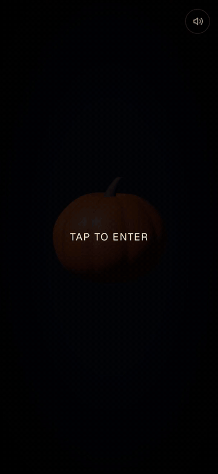

# Glowkin

**Carve a pumpkin in 3D and watch it light up the dark.** The Halloween 2026 experiment of [t/ playground](../../README.md).

▶️ **[Play at playground.oksana.dev/halloween](https://playground.oksana.dev/halloween)**

<p align="center">
  
</p>

## What you can do

1. **Carve.** Draw on the pumpkin with mouse or finger. Three brush sizes, undo and clear.
2. **Or pick a template.** Faces, shapes and a "Dev" set of code-themed carvings (`{ }`, `404`, `</>`), or the dice for a random one. Templates are carved by an animation, stroke by stroke.
3. **Light it.** A match strikes, sparks fly, and the candle inside the pumpkin lights up every cut.
4. **Look around.** After the reveal, drag to orbit the glowing pumpkin while bats circle and the music swells.

Sound is on after the first tap (browsers block audio before a gesture) and can be muted at any time; the choice is remembered.

## How it works

The experience moves through four phases (`intro → carving → lighting → reveal`) held in a small Zustand store ([`useCarveStore`](src/store/useCarveStore.ts)). The camera, glow, bloom and audio all react to the phase.

### Carving

There is no geometry cut. Drawing paints into a **mask canvas** (1024 px, 512 px on touch devices), and a fragment shader reads that mask:

- Pointer hits are projected onto the pumpkin's front lobe with a planar mapping; the same constants (`CARVE_EXTENT`, `FRONT_THRESHOLD` in [`projection.ts`](src/lib/carve/projection.ts)) feed both the pointer code and the shader as uniforms, so they cannot drift apart.
- [`carveShader.ts`](src/components/scene/carveShader.ts) (via `three-custom-shader-material` on top of `MeshStandardMaterial`) discards fragments where the mask is above 0.55, which opens the hole, and tints the rim of the cut with warm flesh color.
- Strokes are drawn with a `lighten` composite so overlapping marks never build up alpha, plus a wider translucent pass for a soft edge. This avoids `ctx.filter`, which iOS Safari does not support.

### Glow

A single `glow` value (0 → 1) eases toward its target when the phase changes and is read every frame without re-rendering React.

- The shader turns it into emissive light on the edges of the cuts.
- An inner, back-faced shell of the same geometry (scaled to 0.93) glows like lit flesh, and the candle's point light sits inside it.
- Bloom intensity is interpolated between idle and lit, with a vignette on top.
- The flame brightness is a mix of three sines, always within 0.7–1, so it flickers without randomness ([`flicker.ts`](src/lib/carve/flicker.ts)).

### Templates

The "Dev" templates are text (`404`, `</>` and so on) turned into strokes with the single-line Hershey Simplex font. [`scripts/build-templates.mjs`](scripts/build-templates.mjs) converts the glyphs at build time, so only the generated strokes ship to the browser, never the font data.

### Sparks and bats

- **Sparks** are a GPU particle system: origin, velocity, delay, lifetime and size are generated once, and the vertex shader animates them from a start-time uniform with additive blending. Some escape through the top of the pumpkin.
- **Bats** fly along Catmull-Rom paths in rounds (three bats, staggered, with a random pause between rounds), with eased scale at both ends so they never pop in.

### Audio

[Howler](https://howlerjs.com) plays five sounds. [`audioMix.ts`](src/lib/audio/audioMix.ts) is pure logic that maps each phase to target volumes for the looping layers (night ambience, crackle, music) and the director cross-fades them. The carve scrape follows the pointer speed: faster strokes are louder and higher-pitched. The long music track streams (`html5`) instead of being decoded up front.

### Models and mobile

Both models are generated by code (no textures, no UVs, no compression), see [`MODELS.md`](MODELS.md). On touch devices the mask is smaller, the pixel ratio is capped at 1.5, and the toolbars move to the thumb-friendly bottom edge.

## Run locally

From the repository root:

```bash
pnpm install
pnpm --filter @playground/halloween dev
```

Open <http://localhost:3001/halloween>. The app is served under `basePath: '/halloween'`, so every asset URL goes through [`assetPath`](src/lib/basePath.ts).

```bash
pnpm --filter @playground/halloween test    # vitest
pnpm --filter @playground/halloween lint
pnpm --filter @playground/halloween build
```

### Regenerating assets

```bash
pnpm --filter @playground/halloween build:templates         # Dev templates -> src/lib/carve/templates.generated.ts
node scripts/generate-models.mjs public/models              # pumpkin.glb, candle.glb (run from apps/halloween)
node scripts/generate-audio.mjs                             # carve scrape and crackle loops (needs ffmpeg)
```

## Credits and licenses

- **Music:** [Horror Scene Halloween Cinematic Trailer](https://pixabay.com/music/horror-scene-halloween-cinematic-trailer-619319/) from Pixabay (`public/audio/music.mp3`).
- **Sound effects** from Pixabay:
  - [Crickets and owl](https://pixabay.com/sound-effects/nature-crickets-and-owl-106422/) (`public/audio/crickets-and-owl.mp3`)
  - [Strike a match](https://pixabay.com/sound-effects/film-special-effects-strike-a-match-381917/) (`public/audio/match-strike.mp3`)
- Pixabay files are used under the [Pixabay Content License](https://pixabay.com/service/license-summary/).
- **Procedural:** the pumpkin and candle models, and the carve scrape and crackle sounds, are generated by the scripts above.
- **Hershey Simplex font** by Dr. A. V. Hershey (U.S. National Bureau of Standards), through the MIT-licensed [`hersheytext`](https://www.npmjs.com/package/hersheytext) JSON port.
- **UI fonts:** Geist, Geist Mono and JetBrains Mono via `next/font`.
